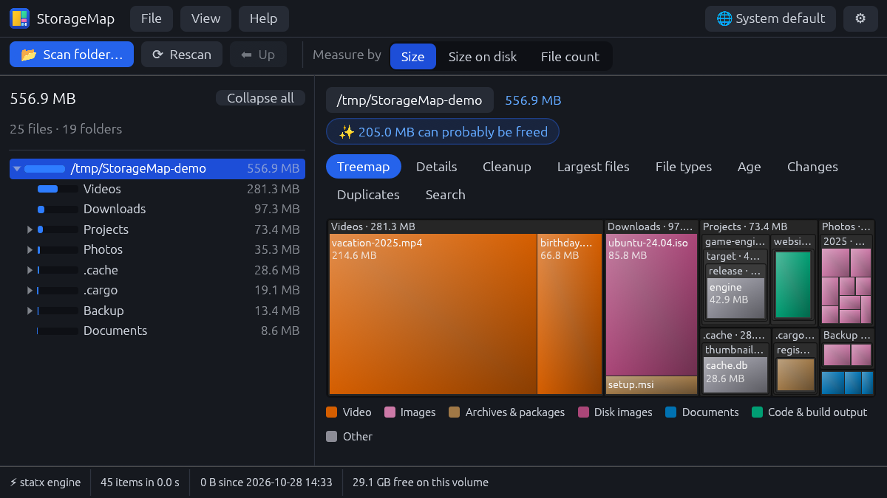
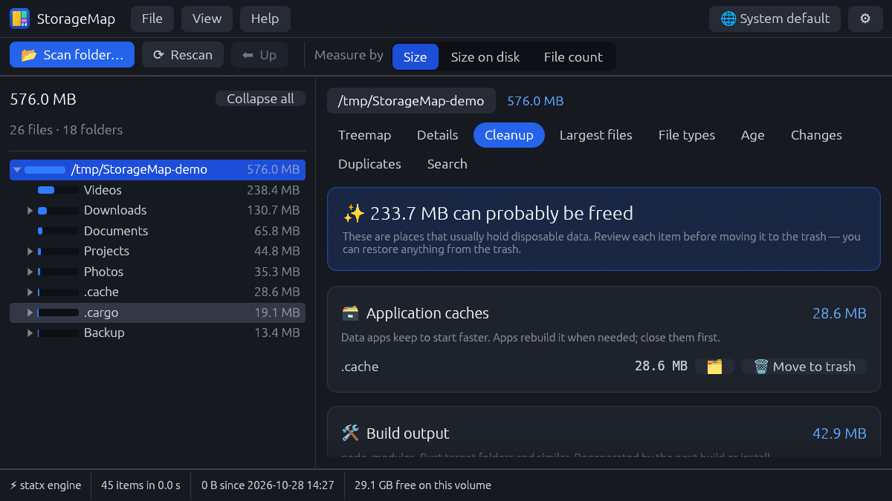
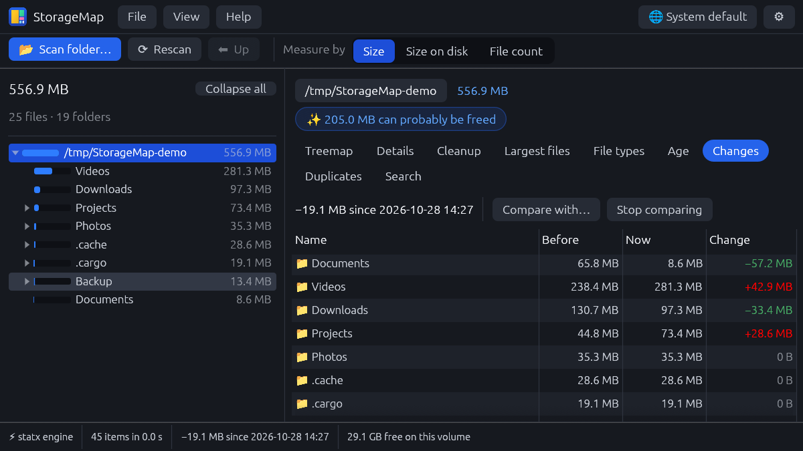
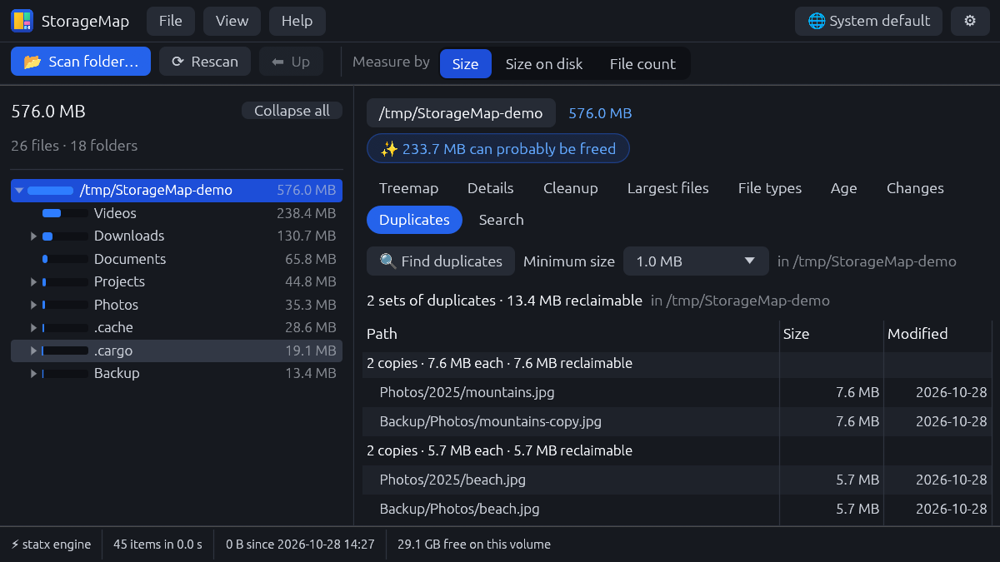
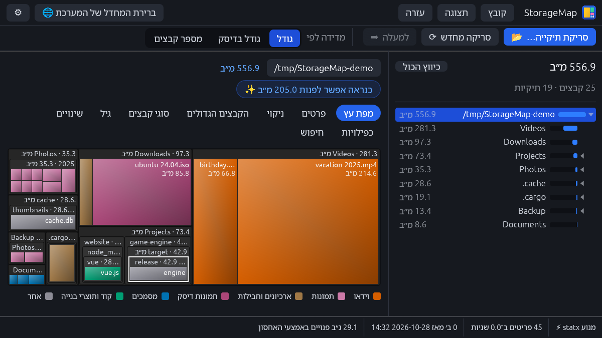
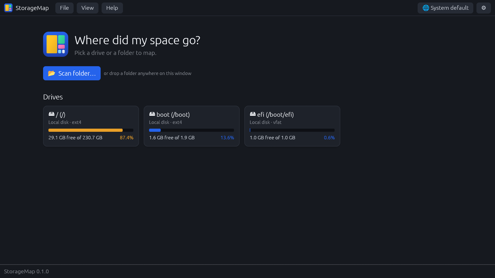
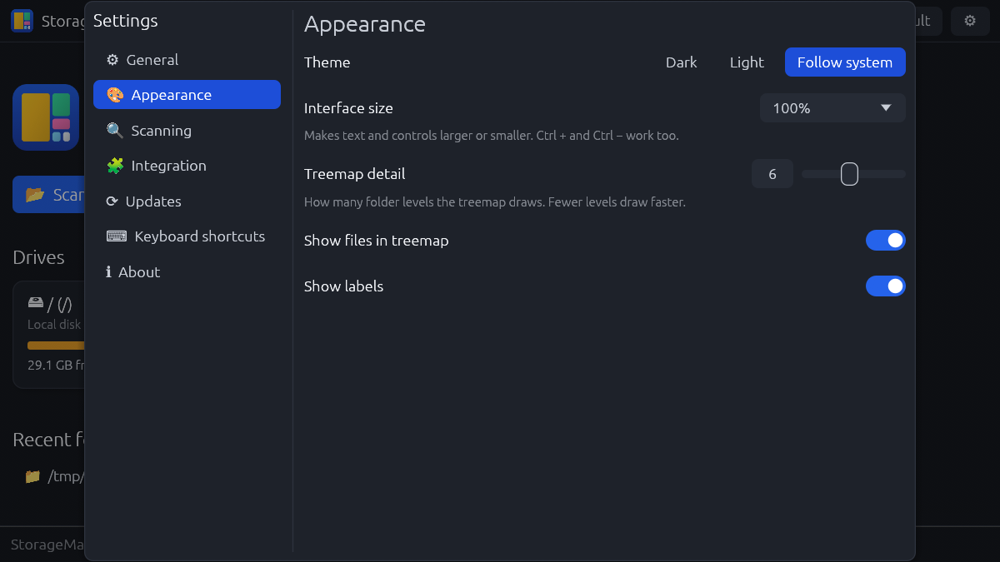

  

<h1 align="center">StorageMap</h1>

  <b>See where your disk space went, and get it back.</b> 
  A fast, free disk space analyzer for Windows and Linux.

  <a href="https://github.com/sudo-py-dev/StorageMap/releases/latest"><b>Download</b></a> ·
  <a href="#features">Features</a> ·
  <a href="#install">Install</a> ·
  <a href="#faq">FAQ</a>

  

StorageMap scans a drive or folder in seconds and shows what takes up the
space: as a treemap where every rectangle is a file, as a sortable folder
tree, and as lists of the largest files and file types. It then helps you
free space safely, by pointing out caches, build leftovers, old downloads
and duplicate files, and it remembers each scan so you can see what grew
since last time.

## Features

- **Fast scans.** On Linux it reads many folders in parallel. On Windows,
  run as administrator, it reads the NTFS file table directly, which is
  usually many times faster than listing folders one by one.
- **Treemap.** Every file is a rectangle sized by how much space it takes,
  coloured by type: video, images, audio, archives, documents, code and
  more. Double-click a folder to zoom in.
- **Folder tree and details.** Folders sorted by size with share bars, plus
  a sortable table with size, size on disk, file counts and dates.
- **Cleanup suggestions.** Finds space that is usually safe to free: the
  trash, application caches, build output such as `node_modules`,
  package-manager caches, temporary files, huge logs, crash dumps and large
  downloads you haven't touched in six months.
- **What changed.** Each scan is saved as a snapshot, so scanning the same
  folder again shows exactly what grew, shrank, appeared or disappeared.
- **Duplicate finder.** Finds files with identical content and shows how
  much space removing the extra copies would free.
- **Largest files, file types and age.** See which files are biggest, which
  kinds of files use the most space, and how much of it is years old.
- **Safe by design.** Nothing is ever deleted outright. Files go to the
  Recycle Bin or Trash after you confirm, so you can always restore them.
- **Your language.** English, Hebrew and Arabic, with a fully mirrored
  right-to-left layout.
- **Light and dark themes**, adjustable interface size, keyboard shortcuts,
  and drag-and-drop: drop a folder on the window to scan it.
- **Automatic updates.** StorageMap checks for new versions once a day, and
  you can turn that off.

## Screenshots

<table>
  <tr>
    <td width="50%"> <b>Cleanup</b>: caches, build output and old downloads, grouped and explained.</td>
    <td width="50%"> <b>Changes</b>: what grew or shrank since the last scan.</td>
  </tr>
  <tr>
    <td> <b>Duplicates</b>: identical files and the space they waste.</td>
    <td> <b>Right-to-left</b>: the whole interface in Hebrew.</td>
  </tr>
  <tr>
    <td> <b>Start screen</b>: your drives and how full they are.</td>
    <td> <b>Settings</b>: language, theme, interface size and more.</td>
  </tr>
</table>

## Install

Download the latest version from the
[Releases page](https://github.com/sudo-py-dev/StorageMap/releases/latest).

| System | File | How |
|---|---|---|
| **Windows 10/11** | `StorageMap-…-windows-x64-setup.exe` | Run it. No administrator rights are needed. |
| Windows, portable | `StorageMap-…-windows-x64-portable.zip` | Unzip and run `storagemap.exe`. |
| **Ubuntu, Debian, Mint** | `storagemap_…_amd64.deb` | Open it with your software installer, or run `sudo apt install ./storagemap_*_amd64.deb` |
| Other Linux | `StorageMap-…-linux-x86_64.tar.gz` | Extract and run `storagemap`. |

The Windows installer can add **"Open with StorageMap"** to the right-click
menu of folders and drives. On Linux, StorageMap appears in your
applications menu and in "Open With" for folders.

## How to use it

1. **Pick something to scan.** Click a drive on the start screen, choose
   *Scan folder…*, or drop a folder onto the window.
2. **Find the big stuff.** The treemap shows it at a glance. Click a folder
   in the tree on the side to look inside, or double-click a rectangle to
   zoom in.
3. **Free space.** Open the *Cleanup* tab for suggestions, or right-click
   any file or folder and choose *Move to trash*.
4. **Come back later.** Scan the same folder again and open *Changes* to see
   what grew.

Right-clicking any item also lets you open it, show it in your file manager
or copy its path. All shortcuts are listed in *Settings → Keyboard
shortcuts*.

## Privacy

Everything runs on your computer. Your scans, snapshots and duplicate
searches never leave it. The only network request StorageMap makes is the
daily update check, which asks GitHub whether a newer version exists. You
can turn it off in *Settings → Updates*.

## FAQ

**Is it safe to delete what the Cleanup tab suggests?**
Usually, yes. Caches and build output are recreated when needed. Still,
review each item. Everything goes to the Recycle Bin or Trash, so you can
restore it.

**Why does Windows offer "Restart as administrator"?**
As administrator, StorageMap can read the NTFS file table directly, which
makes scanning a whole drive much faster. Without it, StorageMap still works,
just more slowly.

**Why don't the folder sizes match Explorer exactly?**
StorageMap can show the *logical size* (what the files contain) or the *size
on disk* (what they occupy, including compression and block rounding).
Switch between them with *Measure by* in the toolbar. Hard links are counted
only once.

**How do I uninstall it?**
On Windows, use *Settings → Apps*. On Debian or Ubuntu, run
`sudo apt remove storagemap`.

## Building from source

See [docs/DEVELOPMENT.md](docs/DEVELOPMENT.md) for building, the project
layout, how scanning and right-to-left text work, and how to add a language.

## License

StorageMap is available under either the [MIT](LICENSE-MIT) or the
[Apache 2.0](LICENSE-APACHE) license, at your option.
